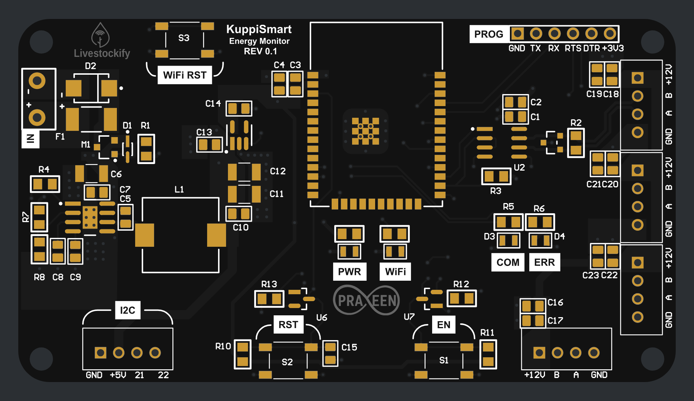
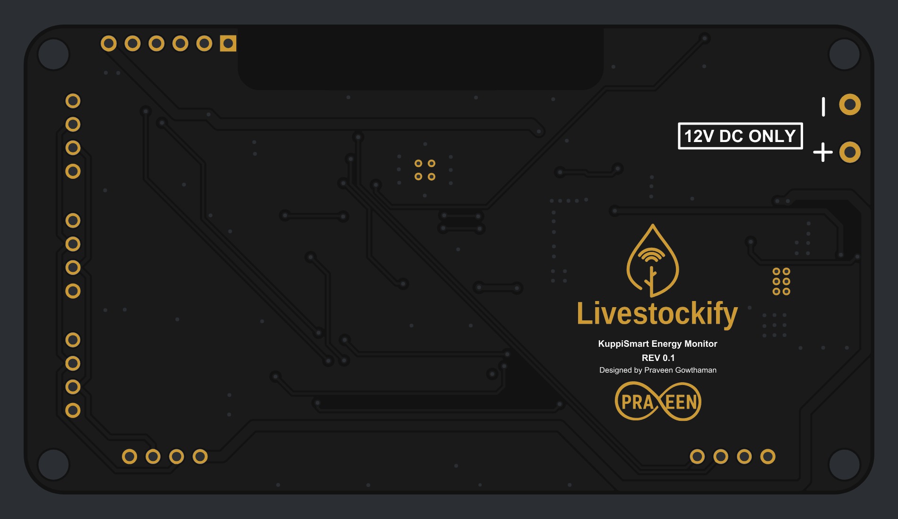

# KuppiSmart Energy Monitor (REV 0.1)

Energy monitor board designed in Altium Designer by Praveen Gowthaman for KuppiSmart / Livestockify. Hand-soldered, first fabricated board (Oct 2026).

## PCB

| Top | Bottom |
|---|---|
|  |  |

Board size: 90.4 x 50.0 mm. Black solder mask, gold pads. Renders generated from the Gerbers.

## Files

- [`Energy_Monitoring_Schematic_REV0.1.pdf`](Energy_Monitoring_Schematic_REV0.1.pdf) - schematic
- [`Project Outputs for Energy_Monitoring/Energy_Monitoring_Gerber_2026-10-20.zip`](Project%20Outputs%20for%20Energy_Monitoring/Energy_Monitoring_Gerber_2026-10-20.zip) - Gerber files
